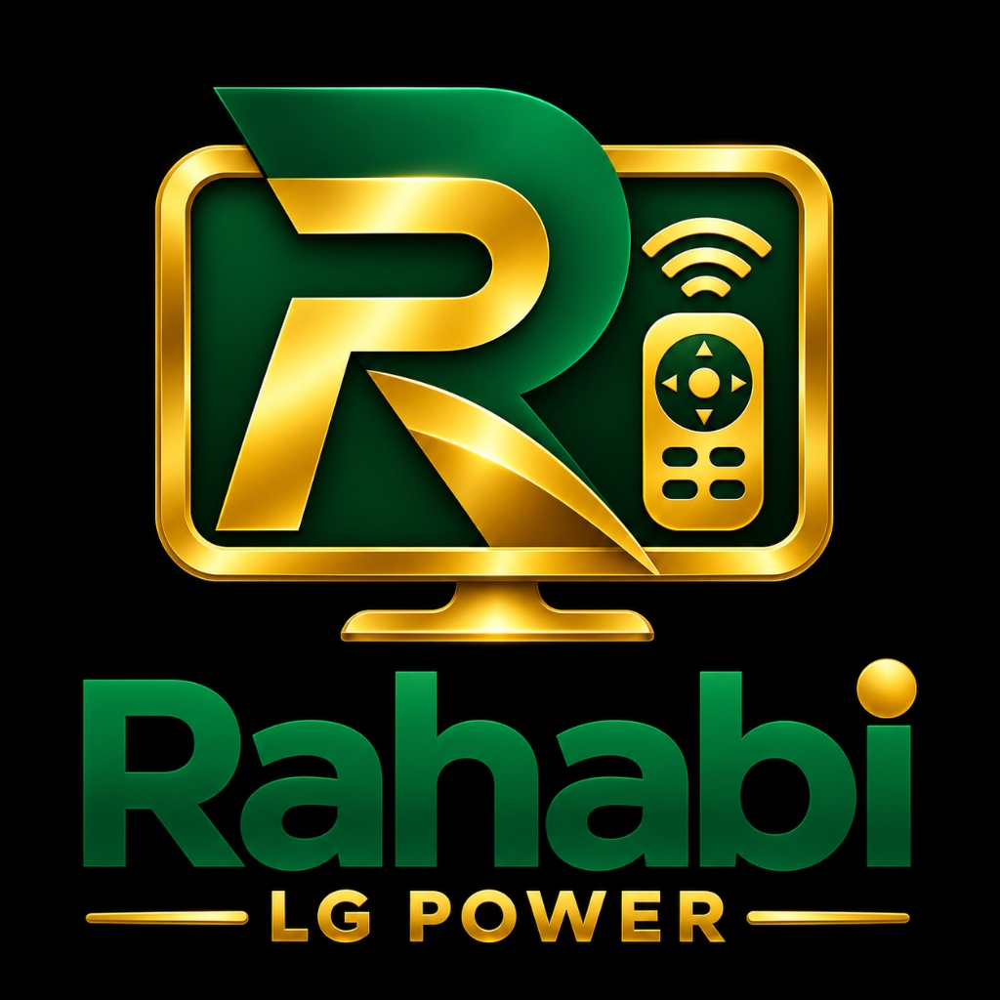
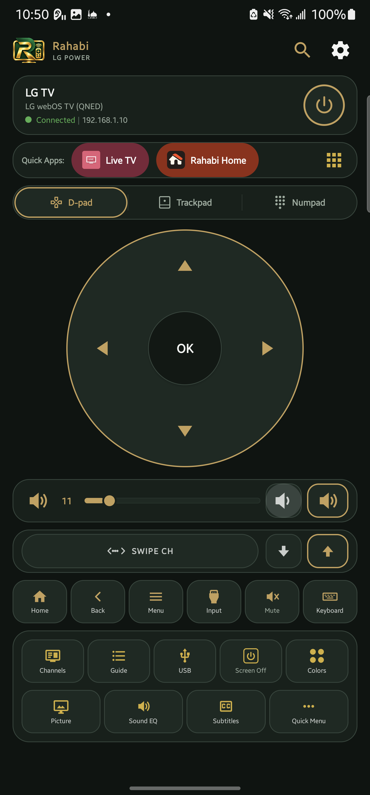
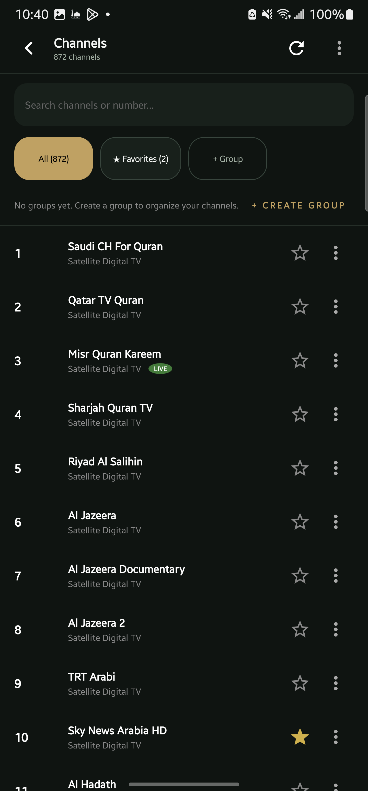
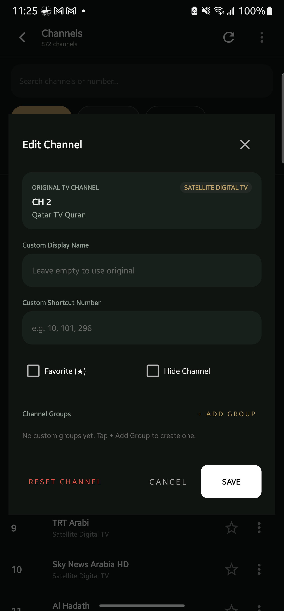
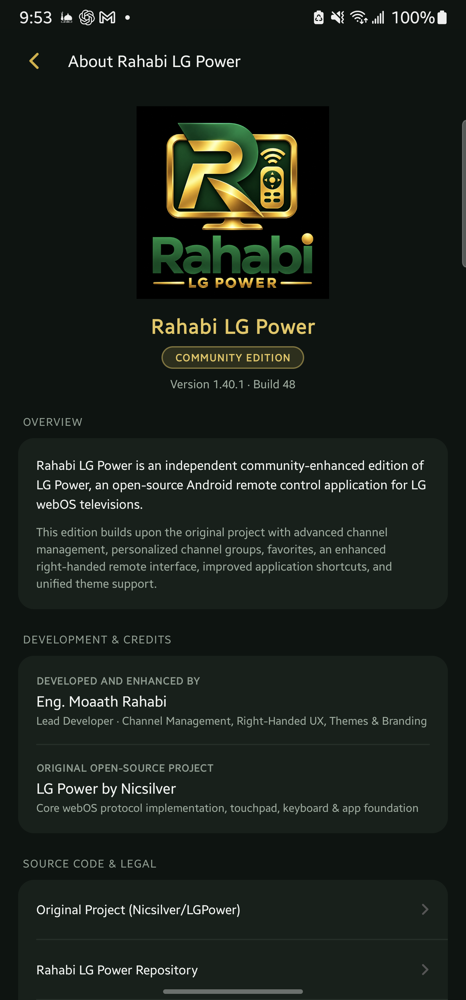
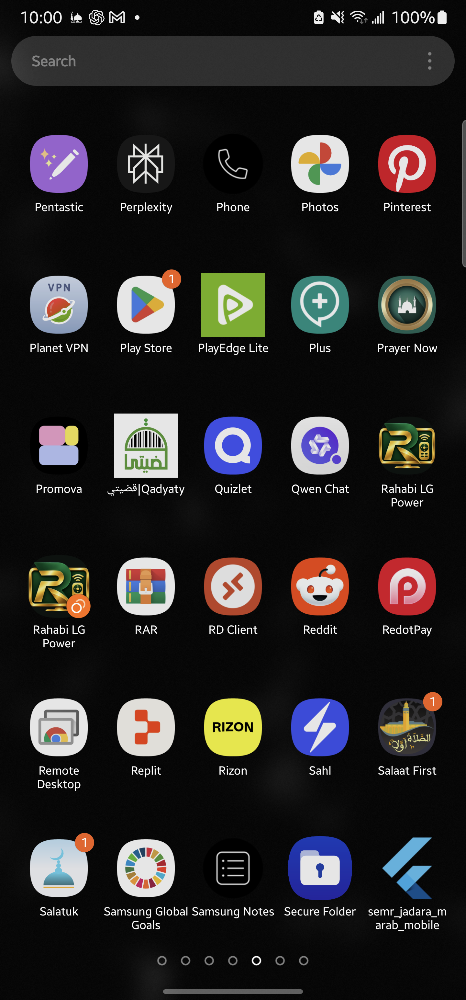

<p align="center">
  
</p>

<h1 align="center">Rahabi LG Power</h1>
<p align="center">
  <b>A Community-Enhanced Open-Source Remote Control for LG webOS Televisions</b><br>
  <i>Developed and enhanced by <b>Eng. Moaath Rahabi</b> · Based on <b>LG Power</b> by <b>Nicsilver</b></i>
</p>

<p align="center">
  
  
  
  
</p>

<p align="center">
  <a href="https://github.com/moaath-rahabi/lgpower-rahabi/releases/latest">
    
  </a>
</p>

---

## Overview

**Rahabi LG Power** is an independent, community-enhanced distribution of the open-source **LG Power** remote control for LG webOS smart TVs.

While retaining the rock-solid connection engine, Wake-on-LAN protocol, and low-latency pointer tracking of the original project, the **Rahabi Community Edition** introduces a complete ergonomic overhaul, an advanced TV channel management suite with custom grouping, a unified dynamic theme engine, and premium right-handed one-handed usability.

No accounts, no advertisements, no tracking, and no cloud dependency — completely private over your local network.

---

## Key Features

### 📺 Advanced TV Channel Management
- **Full Channel Synchronization:** Automatically imports, indexes, and caches your TV's live channel lineup (supporting 870+ channels without lag).
- **Instant Search:** Real-time search across channel names, callsigns, and numbers.
- **Personalized Channel Groups:** Create, rename, delete, and filter custom user categories (e.g. *Sports*, *News*, *Movies*, *Kids*).
- **Favorites System:** One-tap favorite toggling with instant access via the dedicated *Favorites* tab.
- **Local Customization:** Override channel broadcast names, edit logical channel numbers, and multi-digit jump directly to specific broadcasts.
- **Safety & Reset:** Non-destructive per-channel customization reset and one-tap global reset to restore factory broadcast data at any time.

### 📱 Ergonomic Right-Handed Remote Layout
- **One-Handed Thumb Reach:** Control cluster specifically engineered for single-handed right-thumb operation.
- **Full-Width Surfaces:** Dedicated full-width D-pad surface, fluid mouse trackpad, and high-density Numpad.
- **Continuous Gesture Controls:**
  - **Horizontal Volume Scrubber:** Real-time smooth volume adjustment slider with discrete tap-stepping.
  - **Vertical Channel Swipe Trackpad:** Swipe up/down anywhere on the dedicated capsule to flick through channels effortlessly.
- **Quick Controls Card:** Direct access to USB Media Player, Program Guide, Screen Off (audio continues playing), Quick Menu, Picture Modes, Sound EQ, and Subtitles.
- **Quick Apps Rail:** Two-tap launch bar for your installed TV streaming applications.

### 🎨 Unified Theme Engine
- **Full App Theming:** Seamless theme consistency applied across all screens (`MainActivity`, `ChannelsActivity`, `SettingsActivity`, `AboutActivity`).
- **9 Authentic Color Palettes:**
  - **Rahabi Charcoal Gold** (Signature deep emerald & gold edition)
  - **Nord** (Polar night slate & arctic snow frost)
  - **Dracula** (Vibrant dark purple & cyan accents)
  - **Catppuccin** (Soothing pastel dark)
  - **Monokai** (Classic developer high-contrast)
  - **Light & Dark** (Standard Material themes)
  - **One Light & Solarized Light** (Daylight-optimized palettes)
- **High-Contrast Polish:** Optimized label contrast ensuring crisp readability across all lighting environments.

---

## Screenshots

<p align="center">
  
  
  
</p>

<p align="center">
  
  
</p>

---

## Supported TV Models

- **All LG webOS versions (2014–2026):**
  - webOS 1.0 through webOS 6.0 (legacy NetCast / older LCD sets)
  - webOS 22, 23, 24
  - **webOS 25 & webOS 26** (including 2025/2026 OLED & QNED series where upstream pairing protocols changed)
- **Verified Real Hardware:** Tested and verified on **LG 55QNED70B6T** (webOS 26).

---

## Setup & Pairing

1. Connect your Android phone to the same Wi-Fi network as your LG TV (or phone mobile hotspot).
2. Launch **Rahabi LG Power**. The app will discover available TVs automatically via SSDP/mDNS.
3. Tap your TV in the list and accept the pairing prompt displayed on your TV screen.
4. Your pairing key is stored securely on your phone. Subsequent launches connect instantly.

> **Wake-on-LAN Tip:** Ensure your TV has **"Turn on via Wi-Fi"** enabled under:  
> *Settings › General › Devices › External Devices › TV On With Mobile*  
> (On 2025+ models: *Settings › Support › IP Control Settings › Wake on LAN*).

---

## Build from Source

### Prerequisites
- Android SDK (API 36, minimum API 26)
- JDK 17 or newer

```bash
git clone https://github.com/moaath-rahabi/lgpower-rahabi.git
cd lgpower-rahabi
./gradlew assembleDebug
```

The compiled APK will be generated at:  
`app/build/outputs/apk/debug/app-debug.apk`

---

## Attribution & Credits

- **Original Project & Core Engine:**  
  [LG Power](https://github.com/Nicsilver/LGPower) created by **Nicsilver** and contributors.  
  *Core webOS WebSocket client, pointer session protocol, IR fallback, and foundational remote mechanics.*

- **Community Edition Lead Developer:**  
  **Eng. Moaath Rahabi**  
  *Advanced TV channel synchronization, custom channel groups, favorites, right-handed ergonomic UX redesign, unified theming system, and branding.*

---

## License

This project is licensed under the **GNU Affero General Public License v3.0 (AGPL-3.0)**.  
See the [`LICENSE`](LICENSE) and [`NOTICE.md`](NOTICE.md) files for complete details.

---

## Disclaimer

**Rahabi LG Power** is an independent community open-source project. It is not affiliated with, endorsed by, or connected to **LG Electronics Inc.** *LG*, *webOS*, and related marks are trademarks of LG Electronics Inc.
